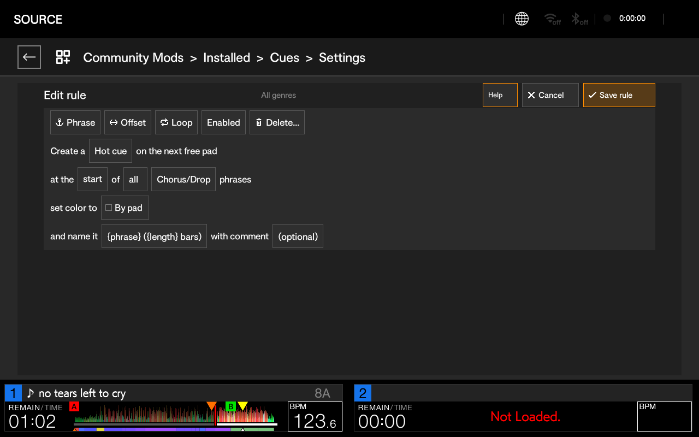
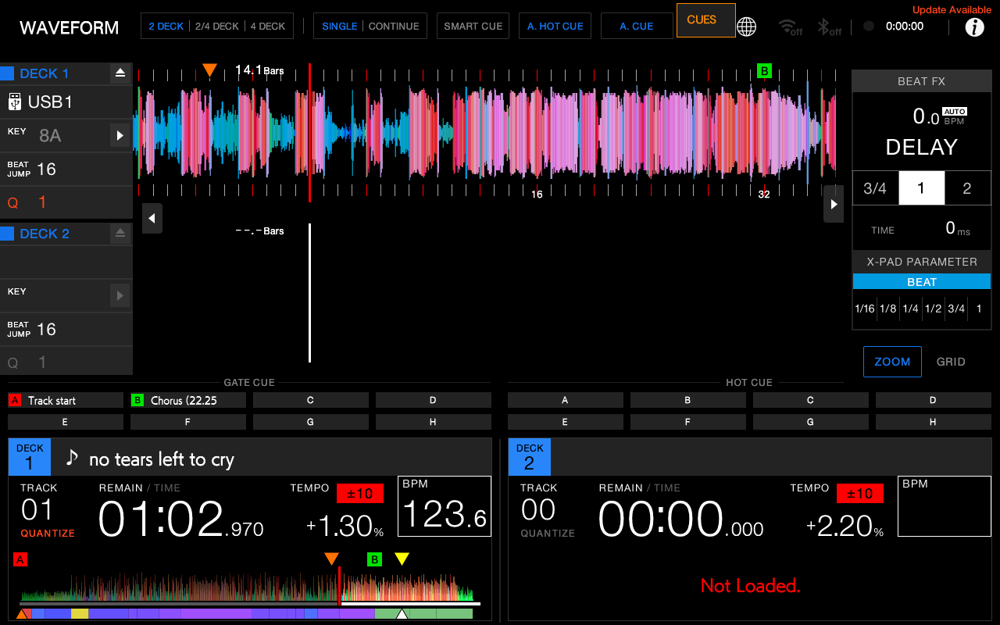

# Cues

Cues creates hot cues, memory cues, and saved loops from rules you set on the deck. Requires AZ-MODS 1.2.9 or later.

## Create a rule

1. Open **Mod Menu → Community Mods → Installed → Cues → Settings**.
2. In **Groups**, open a group or choose **+ Add group**. For a new group, enter a **Group name** and choose **View rules**. Use **Edit group** to filter by artist, key, or BPM.
3. Choose **+ Add rule**. Tap a value in the sentence or select it with the browse knob. Choose **Hot cue** or **Memory cue**.
4. Tap the placement button in the toolbar to switch between **Phrase** and **Absolute**.

   - **Phrase** uses the start, middle, or end of a phrase. Choose the phrase type and an occurrence such as **all** or **1st**. Turn on **Offset** to shift the cue. For example, **-16 bars** from the phrase end places it 16 bars before the end.
   - **Absolute** uses a fixed position in seconds, beats, or bars. Set **0 seconds** for the exact start of the track.

5. Choose a color, name, and optional comment. For an Absolute or numbered Phrase hot cue, choose a pad **A–H**. Turn on **Loop** and set a length or a phrase boundary to save a loop.
6. Choose **Save rule**, then **Apply draft changes** to activate the rules and queue a save to USB. Check **Files** for save status.

For the example below, choose **Hot cue**, then set the Phrase values to **start**, **all**, and **Chorus/Drop**. Each match takes the next free pad. Choose **By pad** to use that pad's color. Set **Units for new rules** to **Bars** in **Edit group** and use `{phrase} ({length} bars)` for the name to get labels like `Chorus (32 bars)`.

Choose **Help** in Settings or the rule editor for an on-deck walkthrough.

## Apply rules to a track

Load a track, open the waveform, and tap **CUES**. Choose the deck. If prompted, choose **Replace** to overwrite the track's entire cue bank.

With the example preset, hot cue **A** marks the track start and hot cue **B** marks the chorus start. Orange and yellow triangles mark memory cues 32 and 16 bars before the chorus ends, respectively.

To run rules automatically, turn on **Config → Apply on track load** and apply the draft. Automatic placement is off by default and skips tracks with existing cues or saved loops. Phrase rules need phrase analysis. Beat and bar positions need a beat grid.

## Back up or import rules

Cues saves rules to `MODS/community-mods/cues/data/cue-rules.json` on the installation USB. Copy that file to back up your rules. To use the [example preset](examples/cue-rules.json), replace the file while Cues is stopped, then restart AZ-MODS or the deck. The preset enables automatic placement.

See [TESTING.md](TESTING.md) for build and validation instructions.
