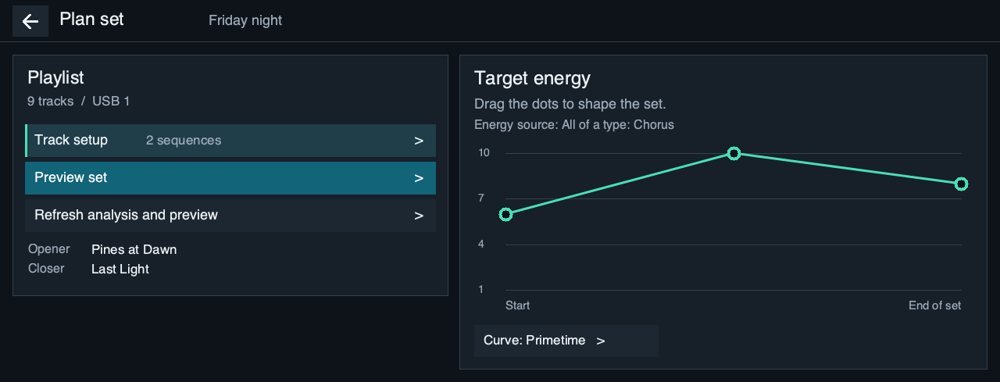
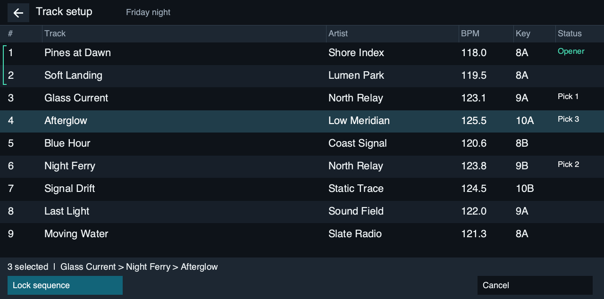
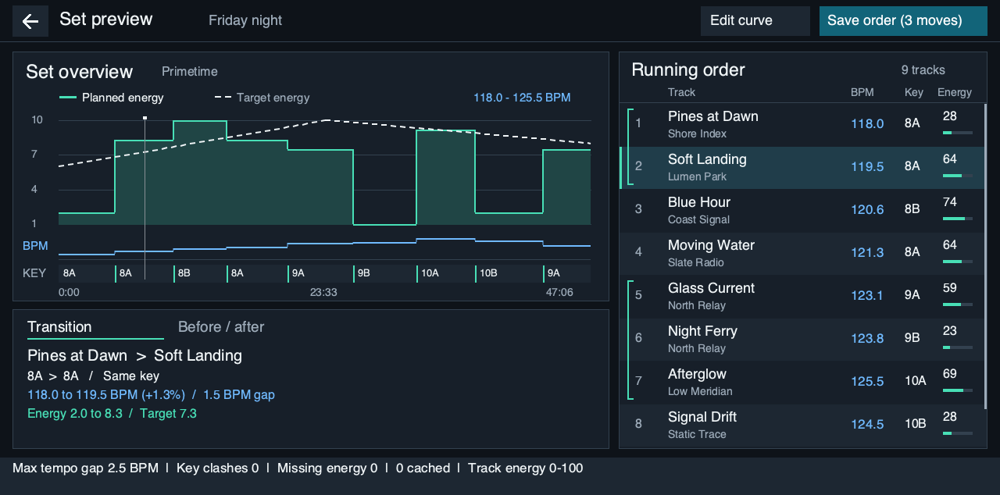

# Set Planner

Set Planner orders a rekordbox USB playlist using harmonic key, effective BPM, and energy from saved analysis. It ports the FletDJ ordering approach, including tempo and energy clustering, transition scoring, and seeded optimization. The deck SDK exposes key, BPM, and duration for this calculation. Genre is unavailable in the playlist metadata.

## Plan a set

Highlight a USB playlist in the deck browser or open its track list. Press the deck’s **MENU** button and tap **Plan Set** in the button row. If the row is full, open **Edit** to find **Plan Set**. **BACK** returns to the browser.



Open **Track setup** to work from the current playlist order before running the planner. Select a track, tap **Start sequence**, then tap more tracks in playback order. Use the browser knob or tap the scrollbar to reach tracks anywhere in the list. Tap **Lock sequence** to place them together in the working list. You can create multiple sequences. Select a grouped track to edit or unlock its sequence. Repeated tracks remain distinct playlist entries.

The teal bracket marks a locked sequence. The **Pick** numbers and the bar above **Lock sequence** show the playback order for the sequence you’re building.



Use **Set as opener** or **Set as closer** to pin a track or its entire sequence at that end of the set. Clear a pin to let the planner choose that endpoint. Tap **Done**, then **Preview set**. The optimizer moves each locked sequence as a unit and scores each track at its planned position. Locks and pins carry over when you rerun the preview in the same planning session. **Save order** writes the reviewed order to the USB playlist.

In **Plan set**, tap **Curve** to cycle through presets. Drag the dots to change energy. Interior dots can also move earlier or later in the set. Drag either end dot up or down to set the opening or closing energy. **Reset to preset** discards your edits. The custom curve applies to this planning session. After reviewing an order, tap **Edit curve** and then **Preview set** to run the planner with your changes.

Change defaults under **Mod Menu → Community Mods → Installed → Set Planner → Settings**.

## Energy source

| Mode | How the track is scored |
| --- | --- |
| Full track | Score all available detail waveform columns over the full track. |
| One phrase | Score the first, middle, or last occurrence of a selected phrase type on each track. An even number of matches uses the earlier middle occurrence. |
| All of a type | Score each occurrence of the selected phrase type and take the median. The default phrase type is Chorus. |

Adjacent phrases of the same type merge when they share a beat boundary. Separated phrases keep their own windows. Phrase windows use the saved beat grid. PWV7 scores combine mean band amplitude, the fraction of active columns, and low-band attacks per beat. If PWV7 is unavailable, the planner estimates energy from PWV5 or PWV3 waveform height. If the selected phrase cannot be scored, it tries the full track. Full-track analysis can take longer than a phrase selection.

The preview shows the track's waveform score rounded to a whole number on a fixed 0–100 scale. The same analysis selection on a track has the same displayed energy across playlists. An asterisk marks a full-track or waveform-height fallback, and a dash means no usable measurement. The planner uses a separate playlist-relative scale for fitting the set's energy curve, with a neutral value for tracks that lack a waveform score.

## Review and save the order

The **Set overview** plots the planned energy in teal against the dashed target, with BPM and Camelot keys below it. Energy here uses the same 1–10 scale as the planner. Gaps indicate missing measurements. When **Use track duration** is enabled, the horizontal axis shows the cumulative track durations available in the library. Otherwise it shows running order.

In this example, both locked sequences are still bracketed in **Running order**. Selecting the second track shows its transition from the opener. **Save order** is at the top right.



For playlists over 60 tracks, the overview groups tracks by position along the set and plots average energy and BPM for each section. The shaded band spans the lowest and highest measured energy in the section. Orange and red bars show the share of transitions with tempo jumps and key clashes.

Tap **Zoom in** to inspect 12 tracks at a time. Use the arrows to move six tracks or drag the scrollbar below the chart to jump to any part of the set. Each track gets an equal amount of space in this view, and the dashed line shows the target energy the planner assigned to each track. **Full set** returns to the overview.

Tap the chart or select a track in **Running order** to inspect the incoming transition. The inspector shows the key move, the original BPM change and the gap used for scoring, and how the incoming track's energy compares with the target. **Before / after** compares key changes, clashes, tempo jumps, and the deviation from the energy target in the USB and planned orders.

Colored markers flag difficult transitions on the incoming track. **Jump** means the BPM gap exceeds the configured tempo warning limit. With half/double tempo enabled, the gap is the smallest difference at original, half, or double tempo. **Key clash** flags keys at least four positions apart on the Camelot wheel.

## USB cache and playlist changes

The mod saves verified energy calculations and their track metadata under
`MODS/community-mods/set-planner/data/track-analysis-v3/` on the USB that installed the mod. Use that USB for the playlist to get persistent caching. Other USB playlists can still be planned and saved. The cache matches the rekordbox track ID, USB-relative path, title, artist, key, BPM, and duration. Full-track, one-phrase, and all-of-a-type scores are cached separately along with how each score was measured. The planner reads current USB metadata to detect changes and recalculates the playlist-relative normalization every time.

Use **Refresh analysis and preview** after reanalyzing tracks in rekordbox if their visible metadata stayed the same. It refreshes the selected mode and clears the other saved scores for each processed track. Tracks missing analysis are retried the next time they are requested.

**Preview set** can update the analysis cache. To write the reviewed order, enable **Playlist Editing** in Mod Menu, select **Save order**, and confirm. The mod verifies the playlist revision, exact entries, and Device Library sync for each move. BACK requests cancellation. A write already accepted by the deck is checked before saving stops. A partial save can be resumed when the current order still matches the verified moves.

## Build and test

Use the ARM64 AZ-MODS SDK toolchain to build `set-planner.so`. The deck needs a core with the public Plan Set menu action, playlist-order, playlist-move, and track-analysis services.

```sh
make AZ_SDK_INCLUDE=/sdk/include OUT=/out
make unit
```
